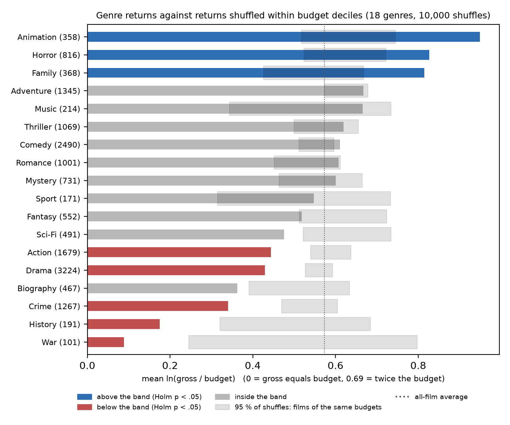

# Q1. Do some genres earn more than others at the same budget?

Three genres return more than films of the same budget and era, and four return less. Animation, Family and Horror sit above what their budgets predict. Drama, Action, Crime and History sit below. All seven pass every shuffle check below on the 6,346 films with usable money. Genre still explains little: on top of budget and era it adds 0.03 to the R² of ln(gross / budget). Every number here comes from `outputs/`, written by `q1_genre.py`.



## How to run it

```bash
IMDB_DATA_DIR=/path/to/data/raw .venv/bin/python -m analysis.genre.q1_genre   # about 5 s, 10,000 shuffles
```

It reads `features/film_analysis_set.csv` and `features/film_genres.csv` (see `docs/analysis-set.md`) and writes only numbers and a figure.

## What it does

These settings were fixed in the script before any genre result was looked at.

- **Films.** Every film with `usable_money` (6,346 films), the shared money rule that calls `analysis/clean_rule.py`. As a head-to-head check, the same tests run on `in_common_set` (1,598 films), the films Q2 and Q3 also use.
- **Outcome.** ln(gross / budget). 0 means the gross equalled the budget and 0.69 means it doubled it. Gross over budget isn't profit, because marketing isn't in the budget and cinemas keep part of the gross.
- **Genres.** IMDb genres with at least 100 films: 18 genres on the full set, 12 on the common set. A film counts in every genre it has (2.61 genres per film on average), so the 18 tests aren't independent. `outputs/overlap.csv` has the overlap. For example, 96 % of History films and 90 % of Biography films are also Drama.
- **Statistic.** The mean ln(gross / budget) of the films tagged with the genre.
- **Null.** The returns are shuffled between films, the genre tags stay where they are, and the genre means are recomputed 10,000 times. The primary shuffle only swaps films within the same decile of ln(budget), so a cheap genre can't win just by being cheap. The p-values are two-sided and Holm-corrected over the genres.
- **Checks.**
  - The shuffle without any budget matching.
  - The shuffle within budget decile × era. Returns fall a lot by decade, so era could stand in for genre.
  - The shuffle within 50 budget bins instead of 10 (redundant: the smooth budget curve in CHECKS.md answers the same worry without any bins). I added this one after the results, when I saw that the lowest decile runs from $5k to $3.2M, which is where most cheap horror films sit.
  - The budget shuffle on the percentile rank of ln(gross / budget). A few micro-budget horror hits such as *Paranormal Activity* sit far out on the log scale, and on ranks each film counts once.
  - A second method: OLS of ln(gross / budget) on all genres together, budget decile and era, with HC3 errors.
- **Left out on purpose.** The vote tier. Votes are partly a result of success, so matching on them would match on the outcome.

## Results

Usable-money set, 6,346 films. Excess is the observed mean minus the mean of the budget-matched shuffle, and exp(excess) turns it into a factor on gross / budget. The last four columns give the Holm p of each test. The OLS column is the genre coefficient minus the mean coefficient (see below).

| Genre | Films | Mean | Excess | × | Budget | Budget × era | No matching | Ranks | OLS, centred (95 % interval) |
|---|---|---|---|---|---|---|---|---|---|
| Animation | 358 | 0.949 | +0.316 | 1.37 | 0.002 | 0.002 | 0.002 | 0.002 | +0.345 (+0.197 to +0.494) |
| Family | 368 | 0.814 | +0.266 | 1.31 | 0.002 | 0.003 | 0.010 | 0.003 | +0.279 (+0.158 to +0.401) |
| Horror | 816 | 0.826 | +0.203 | 1.22 | 0.003 | 0.002 | 0.002 | 0.002 | +0.266 (+0.115 to +0.417) |
| Music | 214 | 0.666 | +0.124 | 1.13 | 0.84 | 0.93 | 1.00 | 0.71 | +0.161 (-0.033 to +0.354) |
| Romance | 1001 | 0.608 | +0.076 | 1.08 | 0.42 | 0.11 | 1.00 | 0.54 | +0.180 (+0.072 to +0.288) |
| Comedy | 2490 | 0.611 | +0.058 | 1.06 | 0.059 | 0.13 | 0.65 | 0.037 | -0.010 (-0.112 to +0.092) |
| Adventure | 1345 | 0.667 | +0.042 | 1.04 | 0.59 | 1.00 | 0.060 | 0.027 | -0.027 (-0.136 to +0.083) |
| Thriller | 1069 | 0.619 | +0.041 | 1.04 | 0.93 | 0.52 | 1.00 | 0.71 | +0.084 (-0.029 to +0.197) |
| Mystery | 731 | 0.600 | +0.034 | 1.03 | 1.00 | 0.38 | 1.00 | 0.71 | +0.107 (-0.024 to +0.239) |
| Sport | 171 | 0.547 | +0.022 | 1.02 | 1.00 | 1.00 | 1.00 | 0.71 | +0.000 (-0.173 to +0.173) |
| Fantasy | 552 | 0.518 | -0.100 | 0.91 | 0.42 | 0.11 | 1.00 | 0.39 | -0.197 (-0.329 to -0.065) |
| Drama | 3224 | 0.430 | -0.130 | 0.88 | 0.002 | 0.002 | 0.002 | 0.002 | -0.180 (-0.274 to -0.085) |
| Action | 1679 | 0.444 | -0.145 | 0.87 | 0.002 | 0.002 | 0.002 | 0.002 | -0.092 (-0.194 to +0.009) |
| Biography | 467 | 0.363 | -0.150 | 0.86 | 0.11 | 0.52 | 0.010 | 0.002 | +0.071 (-0.064 to +0.205) |
| Sci-Fi | 491 | 0.476 | -0.154 | 0.86 | 0.059 | 0.010 | 0.76 | 0.54 | -0.235 (-0.386 to -0.084) |
| Crime | 1267 | 0.341 | -0.197 | 0.82 | 0.002 | 0.002 | 0.002 | 0.002 | -0.142 (-0.238 to -0.045) |
| History | 191 | 0.175 | -0.330 | 0.72 | 0.007 | 0.021 | 0.002 | 0.002 | -0.163 (-0.355 to +0.029) |
| War | 101 | 0.088 | -0.439 | 0.64 | 0.029 | 0.003 | 0.010 | 0.17 | -0.448 (-0.773 to -0.124) |

Matching on budget changes less than we expected. The unmatched excess and the budget-matched excess have the same sign for 17 of the 18 genres (Sport is the exception, close to zero both times). Without matching, nine genres pass: the seven above plus War and Biography. With budget matching Biography drops out and War stays. Horror is the clearest case. Its films are cheap, and matching on budget takes its excess from +0.253 down to +0.203. With 50 budget bins it's +0.195 (Holm p 0.004), so it stays above the band. So the cheap genres don't win just by being cheap. The 50-bin shuffle passes the same eight genres as the decile shuffle, plus Sci-Fi (-0.170, p 0.022).

The regression agrees with the shuffle. Almost every film has at least one of the 18 genres (14 films have none), so the raw coefficients are measured against a near-empty reference and all sit low. Centred on their mean, they rank the genres almost as the shuffle does: Spearman 0.93 against the budget × era excess. They differ where co-genres matter. Holding a film's other genres fixed, Action's interval reaches +0.009 and History's +0.029, so part of their low returns may come from the genres they come with (Drama for History). Biography turns positive, possibly for the same reason, since 90 % of its films are also Drama.

Genre adds little to how well returns can be predicted. Budget decile and era alone give R² 0.063. Adding all 18 genres raises it to 0.096, so genre adds 0.032 (0.030 adjusted).

## On the common set (1,598 films with a script)

This is the set where Q1, Q2 and Q3 are compared head to head. It has 12 genres with at least 100 films, without Animation and Family.

- **Crime** is the only genre that passes every shuffle here: excess -0.200, Holm p 0.002 (budget), 0.010 (budget × era), 0.001 (no matching).
- **Drama** is below with budget matching (-0.088, p 0.006) but not with budget × era (p 0.15).
- **Adventure** is above with budget matching (+0.132, p 0.018) but not with budget × era (p 0.83).
- **Horror** keeps a positive excess (+0.174) but passes only without matching (p 0.013).
- Genre adds 0.026 to the R² (0.020 adjusted), on top of 0.129 for budget and era. The rank agreement with the shuffle is lower than on the full set (Spearman 0.74).

So on the common set, genre tells us a little, and Crime is the one robust signal.

## Before release: genre specialists and script typicality

`q1_before_release.py` ties genre to the people (Q2) and the screenplays (Q3) with two measures that exist before a film comes out. Outputs are in `outputs/before_release/`. It needs IMDb's `title.principals` and `title.basics` (`scripts/get_data.py imdb`) and ran in about 8 min on the HPC.

**Genre specialists.** A film's team is its directors, writers, producers and first three billed actors. Their history is every earlier theatrical film they're credited on in IMDb, noticed or not, with IMDb's genres. Holding genre and a sequel flag fixed, the return net of budget and era rises with how much of the team's earlier work was in the film's genres: +0.084 per SD (+0.032 to +0.137, 6,316 films), and +0.070 with the 783 sequels left out (+0.009 to +0.132). It falls with how spread the team's past is over genres (-0.077). Shuffling genre experience within genre × budget decile and refitting the same model gives p 0.001. The fifth of films whose teams worked most in their genres beats its budget by +0.18.

The first version counted a person's earlier films only among our 12,673 films, which are films that later got 10,000 or more IMDb votes. That let a noticed, successful past leak into "experience". With the full history, the amount of earlier experience stops predicting anything: -0.013 per SD (p 0.56), against +0.105 in the first version. Genre experience and genre breadth barely change. So the leak inflated "experienced teams do well", but not "specialised teams do well". Both versions are in `specialists_ols.csv`.

**Script typicality.** A script is typical when its embedding sits close to the other scripts of its genres, relative to all scripts. A garbled or oddly formatted file would also sit far from its genre. So Q3's script-quality measures are held fixed too: length, dialogue share, scene headings inside dialogue, upper-case and punctuation noise, tiny layers, and on the final 1,598 films the symbol-noise share. Typical scripts beat their budgets: +0.104 per SD without the quality controls, +0.106 with them (+0.047 to +0.166, 1,619 films), +0.101 without sequels, and +0.102 with the symbol-noise share added. None of the quality measures goes with typicality by more than Spearman 0.09 (`typicality_quality.csv`), so typicality isn't file quality. Shuffling it within genre × budget decile and refitting the same model gives p 0.001.

Both measures say films that stay in their genre lane beat their budgets, and neither uses anything from after release. Both are correlations: a specialised team may also pick safer projects, and a typical script may be easier to market.

## Exploratory parts

Some analyses were run and are kept, but they're weak evidence and aren't used for claims: the genre network and its families, genre assortativity, the Tag Genome and plot genre shares, and the Horror word lists. They're in [`exploratory/`](exploratory/README.md), which says why for each. The matched-pairs check in CHECKS.md and the 50-bin shuffle here are redundant with the smooth-curve check.

## What this measures and what it misses

- It measures whether the films tagged with a genre return more than films of the same budget (and era) would on average. It doesn't say the genre causes the return. Horror and Animation could earn more because of who makes them, how they're marketed or which franchises they belong to.
- Gross over budget isn't profit, and the budgets and grosses are parsed from Wikipedia infoboxes.
- The usable-money set only keeps films whose budget and gross were both found. If Wikipedia reports grosses less often for flops, every mean here is too high. The ranking between genres would only shift if that loss differs between genres, and we haven't checked either.
- IMDb genres are tags, not a single main genre, and the 18 tests share films. Holm treats them as separate tests, which is conservative here.
- Some extreme ratios may be parser errors. *Obsession* (2025) shows a $525M gross on a $675k budget and should be checked by hand. The rank test is the guard against a few rows like that. On ranks the same seven genres pass, War doesn't (p 0.17), and Biography, Comedy and Adventure also pass.
- Budget deciles are coarse at the ends. The middle deciles span a factor of 1.3 to 1.6 in budget, but the lowest runs from $5k to $3.2M and the highest from $85M to $405M. The 50-bin shuffle is the check on that.

## Outputs

| File | One row per |
|---|---|
| `outputs/genre_shuffle.csv` | set × outcome × null × genre: mean, median, null mean and 95 % band, excess, z, p, Holm p |
| `outputs/genre_ols.csv` | set × genre: coefficient, centred coefficient, HC3 interval, p |
| `outputs/overlap.csv` | pair of genres: films in both and their share of the first |
| `outputs/summary.json` | settings, film counts, R² with and without genre, rank agreement |
| `outputs/figures/q1_genre.png`, `.pdf` | the figure above |
