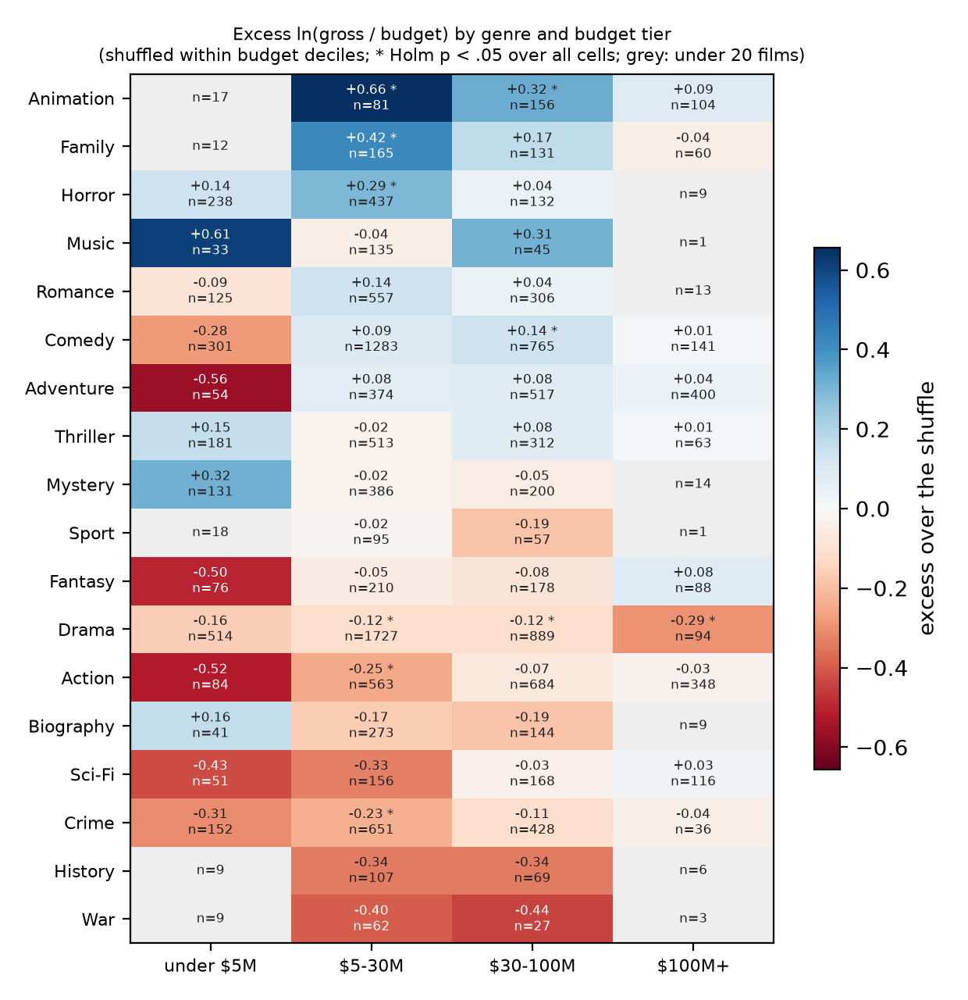

# Q1 follow-up checks: what each one adds

These five checks came after the main results in [README.md](README.md) and don't change them. `q1_checks.py` writes them to `outputs/checks/`, on the same 6,346 films, 18 genres, seed and Holm correction. It takes about 6 s.

```bash
IMDB_DATA_DIR=/path/to/data/raw .venv/bin/python -m analysis.genre.q1_checks
```

In short, none of the five overturns the main result. The seven genres from the main test keep their sign in every check. Two checks add something new. Genre matters most for films costing $5-30M and hardly at all above $100M, except Drama. And Family's edge comes from fewer films grossing less than their budget, while Animation's and Horror's comes from more hits.

## All checks side by side

Excess is on the ln(gross / budget) scale except in the two share columns, which are in percentage points. Holm p is in brackets. The matched column gives a 95 % bootstrap interval instead, with no correction for the 18 genres.

| Genre | Main (budget deciles) | 1 Smooth curve | 3 Without top 10 | 4 Matched pairs | 5 Hit share | 5 Grossed below budget |
|---|---|---|---|---|---|---|
| Animation | +0.316 (0.002) | +0.325 (0.002) | +0.319 (0.009) | +0.347 (+0.218 to +0.473) | +12.2 pp (0.002) | -6.8 pp (0.019) |
| Family | +0.266 (0.002) | +0.236 (0.005) | +0.269 (0.009) | +0.225 (+0.112 to +0.335) | +2.0 pp (1.00) | -7.4 pp (0.013) |
| Horror | +0.203 (0.003) | +0.226 (0.002) | +0.196 (0.018) | +0.362 (+0.236 to +0.490) | +6.2 pp (0.002) | -4.9 pp (0.013) |
| Music | +0.124 (0.84) | +0.138 (0.74) | +0.134 (0.72) | +0.102 (-0.097 to +0.288) | +3.2 pp (1.00) | -2.4 pp (1.00) |
| Romance | +0.076 (0.42) | +0.108 (0.048) | +0.084 (0.35) | +0.177 (+0.093 to +0.262) | +1.6 pp (1.00) | -1.8 pp (1.00) |
| Comedy | +0.058 (0.059) | +0.059 (0.047) | +0.060 (0.049) | +0.087 (+0.030 to +0.142) | +0.7 pp (1.00) | -2.4 pp (0.011) |
| Adventure | +0.042 (0.59) | -0.009 (1.00) | +0.041 (0.54) | +0.050 (-0.018 to +0.116) | +1.7 pp (0.55) | -1.0 pp (1.00) |
| Thriller | +0.041 (0.93) | +0.058 (0.74) | +0.036 (1.00) | +0.129 (+0.034 to +0.224) | +1.4 pp (1.00) | -1.3 pp (1.00) |
| Mystery | +0.034 (1.00) | +0.066 (0.74) | +0.025 (1.00) | +0.109 (-0.012 to +0.223) | +4.5 pp (0.031) | +2.1 pp (1.00) |
| Sport | +0.022 (1.00) | -0.038 (1.00) | -0.002 (1.00) | -0.106 (-0.272 to +0.062) | -5.6 pp (0.66) | +7.2 pp (0.37) |
| Fantasy | -0.100 (0.42) | -0.127 (0.15) | -0.104 (0.35) | -0.092 (-0.205 to +0.022) | -3.1 pp (0.66) | +1.7 pp (1.00) |
| Drama | -0.130 (0.002) | -0.104 (0.002) | -0.129 (0.009) | -0.098 (-0.148 to -0.046) | -3.0 pp (0.002) | +3.4 pp (0.002) |
| Action | -0.145 (0.002) | -0.156 (0.002) | -0.143 (0.009) | -0.246 (-0.310 to -0.184) | -3.2 pp (0.003) | +2.1 pp (0.19) |
| Biography | -0.150 (0.11) | -0.078 (0.74) | -0.140 (0.16) | -0.048 (-0.174 to +0.073) | -5.5 pp (0.031) | +4.7 pp (0.21) |
| Sci-Fi | -0.154 (0.059) | -0.219 (0.002) | -0.153 (0.030) | -0.280 (-0.409 to -0.148) | -1.8 pp (1.00) | +2.2 pp (1.00) |
| Crime | -0.197 (0.002) | -0.200 (0.002) | -0.193 (0.009) | -0.233 (-0.311 to -0.156) | -7.2 pp (0.002) | +4.4 pp (0.003) |
| History | -0.330 (0.007) | -0.292 (0.027) | -0.326 (0.013) | -0.338 (-0.533 to -0.143) | -7.9 pp (0.068) | +11.2 pp (0.012) |
| War | -0.439 (0.029) | -0.532 (0.005) | -0.456 (0.022) | -0.556 (-0.930 to -0.214) | -7.5 pp (0.66) | +7.5 pp (0.77) |

## 1. A smooth budget curve instead of bins

Here ln(gross / budget) is fitted against ln(budget) with a natural cubic spline (5 degrees of freedom) plus era. Each genre's mean leftover is then compared with a plain shuffle of the leftovers (`outputs/checks/smooth.csv`).

It gives the same seven genres as the main test, with the same signs and similar sizes. Three more pass here: Sci-Fi (-0.219, p 0.002), Romance (+0.108, p 0.048) and Comedy (+0.059, p 0.047), and the last two only just. This check has no bin edges to choose, so it replaces the 50-bin check as the answer to "are the deciles too coarse?". It agrees with the main test.

## 2. Genre × budget tier

The films are split into four fixed budget tiers. Within each tier, each genre is compared with a shuffle inside the budget deciles of that tier's films. Cells with under 20 films are left blank (`outputs/checks/tiers.csv`, figure below). Holm runs over all 59 filled cells.



This is the check that adds the most. Ten cells pass, and nine of them are in the $5-30M or $30-100M tiers:

- **$5-30M (1,727 films):** Animation +0.66, Family +0.42, Horror +0.29 above. Action -0.25, Crime -0.23, Drama -0.12 below.
- **$30-100M:** Animation +0.32 and Comedy +0.14 above, Drama -0.12 below.
- **$100M and up (400 films):** only Drama passes, at -0.29. Big-budget films earn about the same whatever their genre.
- **Under $5M:** the cells swing widely (Action -0.52, Music +0.61), but none passes, with 33 to 514 films per cell. Returns spread most in this tier, so a large excess there can still be chance.

So Horror's advantage comes from its $5-30M films (+0.29, 437 films). Its micro-budget films are only +0.14 and don't pass. That's the opposite of the worry that Horror only wins through a few micro-budget hits.

## 3. Without each genre's biggest hits

Each genre's 5 and then 10 highest ratios are dropped, and the shuffle drops the top 5 or 10 in the same way (2,000 shuffles, `outputs/checks/trim.csv`). The dropped films are listed in `outputs/checks/top_films.csv`. For Horror they include *One Cut of the Dead*, *Paranormal Activity*, *Obsession*, *The Blair Witch Project* and *The Gallows*.

Nothing moves. Horror goes from +0.203 to +0.196 without its top 10, and every excess in the table stays within 0.03 of the main one. The handful of extreme films, *Obsession* included, isn't what makes any genre stand out. Sci-Fi passes here (p 0.030) but not in the main test (p 0.059). It sits at the edge in both.

## 3b. Outliers at both ends, across all films

`outputs/checks/outliers.csv`: the main test after removing the most extreme films overall, the biggest hits and the worst flops together, with the budget deciles recut each time. The 20 films of the first cut are listed in `outliers_removed.csv`. The highest include *One Cut of the Dead*, *Paranormal Activity*, *Obsession* and *The Blair Witch Project*, and the lowest *Interstate 60*, *Best Man Down* and *Cherry 2000*.

| Genre | Main | 10 highest and 10 lowest removed | Top and bottom 1 % (126 films) | Top and bottom 5 % (634 films) |
|---|---|---|---|---|
| Animation | +0.316 | +0.329 | +0.322 | +0.248 |
| Family | +0.266 | +0.258 | +0.222 | +0.120 (p 0.09) |
| Horror | +0.203 | +0.195 | +0.173 | +0.146 |
| Drama | -0.130 | -0.128 | -0.124 | -0.099 |
| Action | -0.145 | -0.144 | -0.105 | -0.032 (p 0.62) |
| Crime | -0.197 | -0.205 | -0.192 | -0.138 |
| History | -0.330 | -0.337 | -0.335 | -0.344 |

All seven genres pass with the 20 most extreme films removed, and with the top and bottom 1 % removed (Holm p < .05). With 5 % removed at each end, Animation, Horror, Drama, Crime and History still pass. Family weakens to p 0.09, and Action's deficit nearly disappears (-0.032). So Action earns less mainly because it has more extreme flops, not because typical Action films do a little worse. Cutting 5 % of films at each end throws away real films, so this is the harshest version of the check. *Obsession* sits in the first cut and changes nothing. Removing an outlier tests whether it drives the result, not whether its figures are right. *Obsession* was checked by hand against its article and TMDB, and its figures are real (see the README). The other rows in `outliers_removed.csv` haven't been checked by hand yet.

## 4. Matched pairs (exploratory)

*Exploratory: a different estimand from the main test (comparison films come only from outside the genre), not corrected for testing 18 genres, and it repeats what the shuffle and the regression already show. Kept for the record, not used for claims.*

Each film is compared with the 5 films outside its genre that have the closest budget in the same era. The mean difference gets a 95 % bootstrap interval over the genre's films (`outputs/checks/matched.csv`). This is the most literal reading of "compared with films of similar budgets".

All seven main genres have intervals that exclude zero, with the same sign. Matching is tighter than deciles, and here the comparison films are outside the genre, while the main test compares with all films. So several excesses grow: Horror +0.362 and Action -0.246. Five more genres have intervals that exclude zero (Romance, Comedy and Thriller above, Sci-Fi and War below), but these intervals aren't corrected for 18 genres. Treat them as weaker evidence than the shuffles.

## 5. Hit share and the share below budget

A hit is a film in the top quarter of ln(gross / budget) within its era bin. That's close to Q3's hit, which is cut within genre × era, but genre can't be part of the cut when genre is the thing being compared. Both shares are shuffled within budget deciles (`outputs/checks/shares.csv`).

This shows how each genre gets its result:

- **Animation** has more hits (35.8 % against about 24 % expected, +12.2 pp) and fewer films below budget (-6.8 pp).
- **Horror** has more hits (+6.2 pp) and fewer below budget (-4.9 pp).
- **Family** has no more hits than expected (+2.0 pp, p 1.00) but fewer films that gross less than their budget (-7.4 pp, p 0.013). Family films rarely flop, but they aren't hits more often.
- **Drama and Crime** have fewer hits (-3.0 and -7.2 pp) and more films below budget (+3.4 and +4.4 pp).
- **Action** has fewer hits (-3.2 pp), but no more films below budget than expected (p 0.19).
- **History** has the largest share below budget (+11.2 pp, p 0.012).

For a slide, "an Animation film is a hit 36 % of the time" is easier to say than a mean log ratio.

## What changes in the story

- The seven genres from the main test hold under all five checks, so the main result stands as written.
- **New:** genre matters mostly for mid-budget films. At $100M and up, only Drama is different. That's a better main figure than the bar chart if the paper has room for one more.
- **New:** "earns more" means different things. Animation and Horror get more hits, while Family avoids flops.
- Sci-Fi is borderline. It passes in 3 of the 5 checks but not in the main test, so leave it out of claims.
- These checks were chosen after seeing the main results, so they test its robustness. They aren't separate findings.

## Worst case for films without money (declared on 25 November 2026, before running; post hoc)

`q1_worst_case.py`. The main test sees the 6,346 films with comparable money. The other films with 10,000+ votes from 1975 to 2025 have none, and if one genre's missing films did worse than another's, the ranking would be off. This is a stress test, not an estimate: an unpriced film isn't a flop. It may be foreign, made for streaming, or never reported.

- **Fill.** Every unpriced film gets one bad return: the mean of the worst quarter of the 6,346 returns. Two versions: all unpriced films, and only those with no budget or gross parsed.
- **Test.** The same statistic as the main test (mean return per genre, the same 18 genres, 10,000 shuffles, two-sided, Holm over 18). Unpriced films mostly have no budget, so shuffles are within era only. The priced films alone with the same era-only shuffle are the reference, so any change comes from the fill and not from dropping the budget match.
- **Budget-matched version.** Films with an unflagged US-dollar budget of at least $1,000 but no comparable gross get the same fill and the main test's budget deciles. This is the closest to the main test and covers fewer films.
- **Tipping point.** The fill value at which a genre's excess over its era-only null is zero, with all unpriced films filled.
- **How it is read, fixed in advance.** The eight genres of the main test are judged. A genre *holds* if it keeps its sign at Holm p < 0.05 with all unpriced films filled, *weakens* if it keeps its sign but not the test, and *flips* if the sign changes. All eight are reported. The share of each genre's films that is unpriced is reported, because with one fill value that share drives the result.
- **What it misses.** Films under 10,000 votes, and any pattern in the true missing returns.

**Result** (10,000 shuffles, 4 s on a laptop). Excess, with Holm p in brackets.

| Genre | Unpriced | Main test | Priced only, era null | All unpriced filled | Unparsed only filled | Budget known, no gross, filled (budget null) | Verdict |
|---|---|---|---|---|---|---|---|
| Animation | 36% | +0.316 | +0.431 | +0.450 (0.002) | +0.444 (0.002) | +0.341 (0.002) | holds |
| Family | 26% | +0.266 | +0.247 | +0.442 (0.002) | +0.454 (0.002) | +0.279 (0.002) | holds |
| Horror | 46% | +0.203 | +0.244 | +0.117 (0.004) | +0.095 (0.051) | +0.108 (0.182) | holds |
| Drama | 49% | -0.130 | -0.138 | -0.159 (0.002) | -0.151 (0.002) | -0.118 (0.002) | holds |
| Action | 42% | -0.145 | -0.106 | +0.007 (0.768) | +0.046 (0.453) | -0.166 (0.002) | flips |
| Crime | 47% | -0.197 | -0.241 | -0.193 (0.002) | -0.209 (0.002) | -0.195 (0.002) | holds |
| History | 54% | -0.330 | -0.378 | -0.295 (0.002) | -0.304 (0.002) | -0.337 (0.004) | holds |
| War | 52% | -0.439 | -0.602 | -0.464 (0.002) | -0.502 (0.002) | -0.452 (0.011) | holds |

Seven of eight hold and Action flips. Horror holds by the rule written above, but it misses two of the other versions (Holm p 0.051 and 0.18), so it's weaker than the verdict alone says. The fill also makes Adventure and other genres look better or worse than before, which only reflects their share of unpriced films. The fill value, -1.246, is the worst quarter of these 6,346 films. The tipping points are in `outputs/worst_case/verdict.csv`. They are far outside the observed returns for most genres, and for Horror the tipping point has no meaning because its share of unpriced films is close to average.
